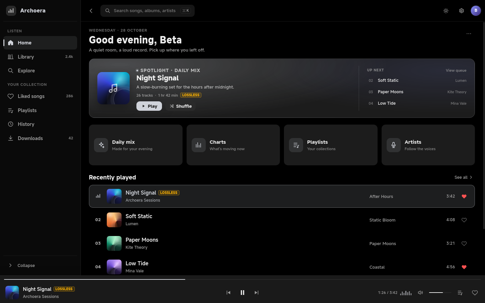
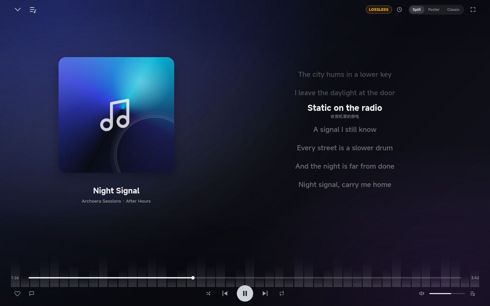

# ArchoeraMusic UI Skill

面向 AI Agent 的可移植 **音乐应用 UI 设计 Skill**，提取自 **ArchoeraMusic** 的界面视觉系统。

它描述的是一个“暗色聆听室”：近黑外壳、单色强调色、封面与歌词提供颜色，底部常驻播放条；全屏播放器是一个独立空间，而不是普通弹窗。

> 这是纯 UI 设计规范，不是播放器源码，也不包含播放、扫描、网络、存储或账号逻辑。

## 预览

| 桌面外壳 | 全屏播放器 |
|---|---|
|  |  |

预览还支持浅色主题、侧栏折叠、三种播放器布局、播放/暂停和喜欢交互。

## 设计语言

- **Dark-first**：深色主题是默认体验，浅色主题是完整对等版本，不是补丁。
- **单色强调**：默认中性灰 `#D0D3DA`（深色）/ `#4A4D54`（浅色），可选自定义 seed 或封面取色；颜色只进入强调、光晕和背景洗色，不染正文。
- **容器有层级，但不重**：控件 `10`、卡片 `12`、对话框/hero `16`、播放器封面 `24`；播放条可为 docked 全宽或 `30` 圆角悬浮。
- **Transport 永不消失**：侧栏 `240 / 64`、顶部栏 `64`、播放条 `82 = 22 + 60`；页面切换不打断播放条。
- **封面驱动的播放器**：`Split`（默认）、`Poster`（整幅封面）、`Classic`（封面/歌词双栏）三种布局，共用 `32` 页面边距与 `56` 顶栏。
- **歌词是内容**：独立的字号、行高、活动行层级和边缘渐隐；不做跑马灯。
- **克制动效**：分支切换 `150 ms`、沉浸淡出 `300 ms`、播放器打开 `500 ms`；封面暂停 `0.9`、播放 `1.0`，不做夸张弹跳。

核心 token：

```text
surface      #000000 / #F7F7F8
panel        #121212 / #FFFFFF
text         #ECECEC / #1A1A1A
primary      #D0D3DA / #4A4D54
player bar   82 px (22 progress + 60 body)
player cover 24 px radius
```

完整 token 见 [`assets/tokens.json`](assets/tokens.json) 和 [`references/tokens.md`](references/tokens.md)。

## 目录

```text
.
├── SKILL.md                 # 技能入口：原则、约束、工作流、检查清单
├── README.md
├── LICENSE                  # AGPL-3.0
├── NOTICE.md                # 来源、字体/图标/封面边界
├── references/
│   ├── tokens.md            # 调色板、强调色模式、字体、间距、圆角、对比度
│   ├── layout.md            # 外壳、侧栏、顶部栏、播放条、设置、断点
│   ├── components.md        # 按钮、输入、列表、卡片、菜单、弹窗、Toast、队列
│   ├── player.md            # Split/Poster/Classic、歌词、背景、transport
│   ├── motion.md            # 时长、曲线、转场、reduced motion、性能
│   └── patterns.md          # 首页、音乐库、搜索、详情、设置、状态、可访问性
└── assets/
    ├── tokens.json          # 机器可读 token
    ├── tokens.css           # CSS 自定义属性和基础配方
    ├── preview.html         # 无依赖交互预览
    ├── preview-shell-dark.png
    └── preview-player.png
```

仓库根目录就是技能目录，`SKILL.md` 是入口；`references/` 和 `assets/` 按需读取。

## 快速开始

### 在 Agent 中使用

1. 获取仓库：

   ```bash
   git clone https://github.com/ArchoeraC/ArchoeraMusic-UI.git archoera-music-ui
   ```

2. 将包含 `SKILL.md` 的整个文件夹放入你的 Agent Skill 目录。
   如果工具要求固定目录名，使用 `archoera-music-ui`。

3. 在任务中明确调用：

   ```text
   使用 archoera-music-ui skill 设计音乐库页面：
   左侧导航、顶部搜索、68 px 歌曲行、底部 82 px 播放条。
   ```

   ```text
   按 archoera-music-ui 的规则审查这个播放页：
   检查三种布局、歌词层级、封面尺寸、背景对比度和 reduced motion。
   ```

### 查看预览

直接打开：

```text
assets/preview.html
```

或启动本地静态服务器：

```bash
cd assets
python3 -m http.server 8000
# http://localhost:8000/preview.html
```

可用参数：

| 参数 | 作用 |
|---|---|
| `?theme=light` | 切换浅色主题 |
| `?view=player` | 直接打开全屏播放器 |
| `&layout=split` | Split 布局 |
| `&layout=poster` | Poster 布局 |
| `&layout=classic` | Classic 布局 |

例如：

```text
assets/preview.html?view=player&layout=poster
assets/preview.html?theme=light&view=player&layout=split
```

预览无外部字体、图标字体、封面图或网络请求；封面是 CSS 渐变，图标是内联 SVG。

## 适用场景

- 桌面或大屏音乐播放器、音乐库、队列、歌词页和 Now Playing。
- 给现有媒体应用换一套暗色、克制、封面驱动的视觉语言。
- 审查音乐界面的层级、密度、对比度、状态和动效。
- 把同一套 token 和组件规则移植到 Flutter、Web、Qt/QML、Compose、SwiftUI 等栈。

## 不适用范围

- 不提供播放引擎、音频管线、扫描、网络、存储或账号系统。
- 不要求使用特定框架；Flex/Grid/Stack 等通用布局概念即可映射。
- 不复制第三方播放器的具体布局、图标、字体或品牌素材。
- 不把业务规则写进 UI 规范；状态和交互只描述视觉结果。

## 来源、署名与许可证

- 设计来源：**ArchoeraMusic**，Copyright (C) 2026 Archoera && BetaStudio2，上游采用 **AGPL-3.0-or-later**。
- 本仓库是独立重述的 UI 设计规范，不包含应用源码、播放逻辑、MiSans 字体文件、图标字体、封面图或品牌素材。
- `assets/preview-*.png` 是本仓库自己的 `preview.html` 截图，不是应用截图。
- 本仓库以 **AGPL-3.0-or-later** 发布，详见 [`LICENSE`](LICENSE)；素材边界见 [`NOTICE.md`](NOTICE.md)。

---

维护：ArchoeraC · Skill version `1.0.0`
